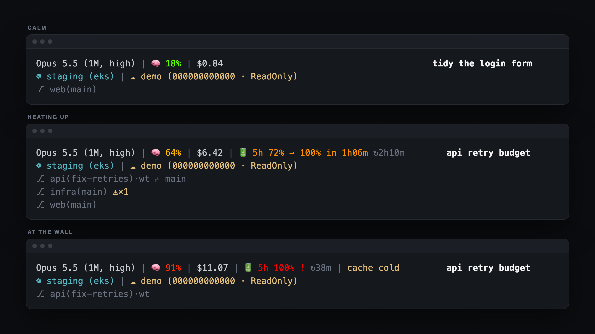
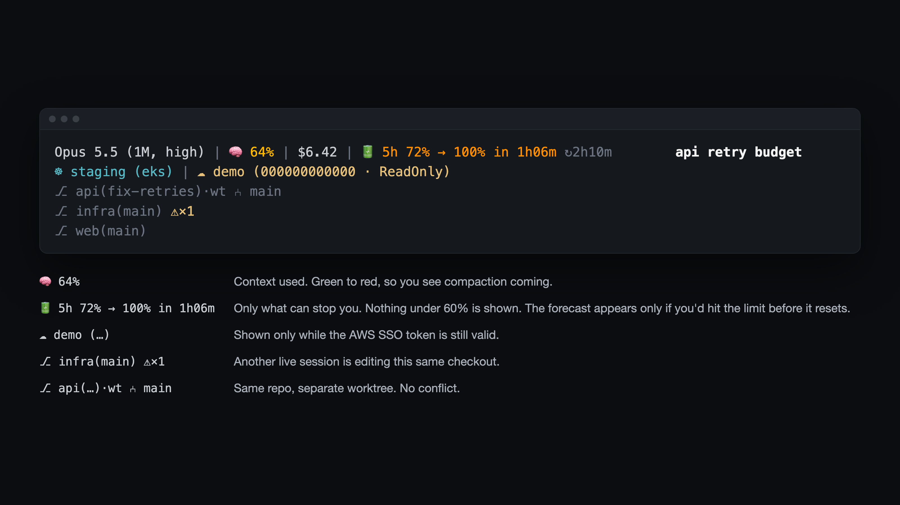

# claude-statusline

A Claude Code status line that stays quiet until something can stop you.



## The rules it follows

1. **Show what can stop you, not everything you have.** At most two limits, worst first. Nothing under 60% gets space. A limit you've hit is marked `!` with the time until it lifts.
2. **Forecast only when it changes the answer.** `→ 100% in 1h06m` appears only when that lands before the window resets. If the reset comes first, there is nothing to say.
3. **Track what this session did, not what git says.** A PostToolUse hook records every repo the session edits or `cd`s into. `git status` can't tell your edits from another session's.
4. **Tell a collision from a worktree.** `⚠×1` means another live session is editing the same checkout. `⑃ main` means another session has the repo in a separate worktree, which is fine.
5. **Show credentials only while they work.** The AWS profile disappears when its SSO token expires.
6. **Never make the render wait.** One `jq` call plus bash builtins. No git, no network. Claude Code cancels a status line that is still running when the next update fires.
7. **Write nothing on most ticks.** Every write is a filesystem event that Spotlight, endpoint security and file watchers all pick up, and this runs in every open session. The liveness marker is rewritten at most once a minute.



## Install

Needs `bash` (the macOS 3.2 one is fine), `jq` and `git`.

```sh
git clone --depth 1 https://github.com/my-neme-eh-jeff/ai-experiments.git
mkdir -p ~/.claude/statusline
cp ai-experiments/claude-statusline/{statusline.sh,touched-lib.sh,touch-record.sh} ~/.claude/statusline/
```

Add to `~/.claude/settings.json`:

```json
{
  "env": { "CLAUDE_STATUSLINE_CODE_DIR": "/Users/you/code" },
  "statusLine": { "type": "command", "command": "~/.claude/statusline/statusline.sh", "padding": 0, "refreshInterval": 15 },
  "hooks": {
    "PostToolUse": [
      {
        "matcher": "Edit|Write|MultiEdit|NotebookEdit|Bash",
        "hooks": [{ "type": "command", "command": "bash ~/.claude/statusline/touch-record.sh", "timeout": 10, "async": true }]
      }
    ]
  }
}
```

`CLAUDE_STATUSLINE_CODE_DIR` is the folder your repos live in, one level deep (`~/code/<repo>`). It defaults to `~/code`. Repos outside it aren't tracked. If the status line doesn't pick it up from `env`, export it in your shell profile instead.

## What it reads and writes

- **Reads:** the JSON Claude Code pipes in, `current-context` from your kubeconfig, the active `AWS_PROFILE` block in `~/.aws/config`, and only `expiresAt` from that profile's SSO cache file. It also reads `effortLevel` from `~/.claude/settings.json`.
- **Writes:** only under `~/.cache/claude-statusline/`. Files older than 14 days are cleaned up once a day by the hook.
- **Never:** makes a network call or prints a token. The SSO cache file holds one, and only its expiry is used.

Limits come from the `rate_limits` field Claude Code sends, which only appears on Pro and Max plans after the first response. Without it, the limit block simply doesn't show.

## Try it without installing

From this folder:

```sh
bash demo/render.sh            # calm, heating, wall
bash demo/render.sh heating
```

The demo runs against made-up sessions in a throwaway HOME. It never touches your real config, and the images above come from it.

## See also

If you want a configurable status line rather than an opinionated one:

- [claude-hud](https://github.com/jarrodwatts/claude-hud)
- [ccstatusline](https://github.com/sirmalloc/ccstatusline)
- [ccusage statusline](https://ccusage.com/guide/statusline)
- [claude-powerline](https://github.com/Owloops/claude-powerline)
- [claude-pace](https://github.com/Astro-Han/claude-pace)
